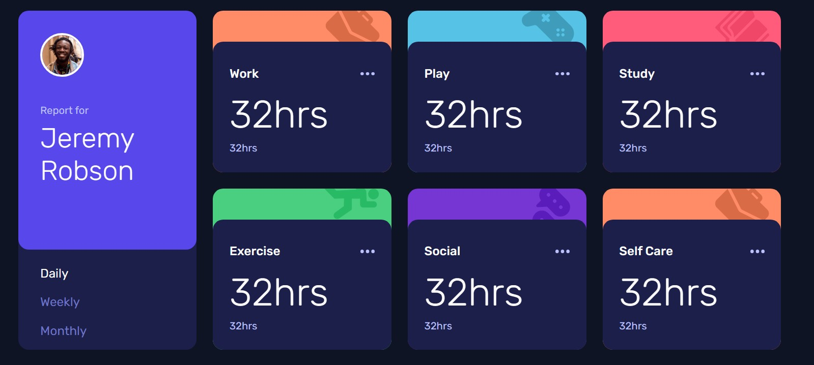

# Frontend Mentor - Time tracking dashboard solution

This is a solution to the [Time tracking dashboard challenge on Frontend Mentor](https://www.frontendmentor.io/challenges/time-tracking-dashboard). Frontend Mentor challenges help you improve your coding skills by building realistic projects.

## Table of contents

- [Overview](#overview)
  - [The challenge](#the-challenge)
  - [Screenshot](#screenshot)
  - [Links](#links)
- [My process](#my-process)
  - [Built with](#built-with)
  - [What I learned](#what-i-learned)
  - [Continued development](#continued-development)
  - [Useful resources](#useful-resources)
- [Author](#author)

## Overview

### The challenge

Users should be able to:

- View the optimal layout for the site depending on their device's screen size
- See hover states for all interactive elements on the page
- Switch between viewing Daily, Weekly, and Monthly stats

### Screenshot



### Links

- Solution URL: [Repository](https://github.com/jonghwascript/time-tracking-dashboard.git)
- Live Site URL: [Live site](https://jonghwascript.github.io/time-tracking-dashboard)

## My process

### Built with

- Semantic HTML5 markup
- CSS custom properties
- CSS Grid
- Flexbox
- Mobile-first workflow
- [Sass/SCSS](https://sass-lang.com/) - modular partials (`_variables`, `_mixins`, `_reset`)
- BEM class naming with role prefixes: `l-` for layout, `c-` for components, `u-` for utilities
- [Gulp](https://gulpjs.com/) - task runner for compiling SCSS to CSS, generating sourcemaps, and formatting with Prettier
- [Browsersync](https://browsersync.io/) - local dev server with live reload and CSS injection

### What I learned

While structuring the markup, I focused on choosing HTML elements based on their meaning rather than their default appearance, and made sure to check the accessibility implications of each choice:

- [Structuring content with semantic HTML](https://developer.mozilla.org/en-US/docs/Learn_web_development/Core/Structuring_content)
- [HTML: A good basis for accessibility](https://developer.mozilla.org/ko/docs/Learn_web_development/Core/Accessibility/HTML)
- [HTML elements reference](https://developer.mozilla.org/ko/docs/Web/HTML/Reference/Elements)

I also learned that loading a font with a `<link>` tag performs better than importing it with `@import`, since the browser can discover and start fetching the stylesheet earlier instead of waiting for the CSS to be parsed first:

```html
<link
  href="https://fonts.googleapis.com/css2?family=Rubik:wght@300;400;500&display=swap"
  rel="stylesheet"
/>
```

A typo also taught me how strict a Sass mixin can be: my `mq()` mixin raises `@error` when it's given a breakpoint name that isn't in the `$breakpoints` map. Passing `'table'` instead of `'tablet'` didn't just skip that media query - it stopped the whole SCSS build from compiling, so the site kept running on stale CSS until I caught the typo.

I also ran into a CSS Grid + Flexbox interaction: a `.box` card shares a grid row with the taller `.reporter` sidebar on desktop, so Grid's default `align-self: stretch` makes `.box` grow to match. But its `.wrapper` child was a plain block box sized to its own content, so it didn't grow with it and left a colored gap at the bottom of the card. Turning `.box` into a flex column and giving `.wrapper` `flex: 1 1 auto` made it fill whatever height `.box` ends up with. (These classes are now `.c-stat`, `.c-stat__body` and `.c-report`.)

Specificity bit me in a way I didn't notice for a while: `<main>` also carried the `.container` class, and a class selector beats a type selector, so every `width` I set on `main` for mobile, tablet and desktop was silently ignored. Measuring the design mockups (327px content at 375px, 612px at 768px, 1110px with 30px gaps at 1440px) showed that `.container` happened to be right on mobile and desktop but not on tablet. I fixed tablet with `max-width`, which `.container` doesn't set, and later merged both into a single `.l-dashboard` class so there's nothing left to conflict.

Refactoring the SCSS to BEM with `l-`/`c-`/`u-` prefixes flattened selectors like `.reporter nav ul li .filter-item input[type='radio']` (six levels deep) into `.c-filter__input:checked + .c-filter__label`. Every rule is now one or two classes, so markup changes no longer break styles. It also let me drop `grid-template-areas`: the cards follow DOM order, so Grid's auto-placement puts them in the right cells as long as the report card spans the full first row on tablet (`grid-column: 1 / -1`) and two rows on desktop (`grid-row: span 2`). I checked the refactor by comparing screenshots before and after at seven widths, including both sides of each breakpoint, plus hover and focus states. They matched pixel for pixel.

I learned to pick CSS units by asking one question: should this value grow when the user enlarges the browser's default font size?

- Font sizes and spacing tied to text use `rem`.
- Breakpoints are written in px in the `$breakpoints` map, but `mq()` outputs them in `em` (`768px` → `48em`). Media-query `em` follows the browser's default font size, so a user with a 32px default font gets the mobile layout even on a wide screen instead of oversized text crammed into four columns.
- Screen-edge gutters use `min(1.5rem, 6.4vw)`. That's 24px at 375px and above, and it stops growing on narrow screens so it doesn't eat the space the text needs.
- Line heights are unitless, written as `math.div(28, 24)` so the design's px values stay readable.
- Hairlines like focus outlines stay in `px`.

Accessibility fixes came from working through a checklist:

- The Daily/Weekly/Monthly radios sit in a `<fieldset>` with a visually hidden `<legend>`, not a `<nav>`, because they filter data rather than navigate.
- A polite `aria-live` region announces "Weekly hours shown" after the numbers update.
- The "…" icons are real `<button>`s with names like "Work options" and a 37×25px hit area. Their visible size stays the same because negative margins cancel out the extra padding.
- The attribution text went from a 2.57:1 contrast ratio to 10.71:1, and its links are underlined.
- The color transition is turned off under `prefers-reduced-motion`.

A few smaller bugs rounded out the JS/HTML wiring: the `.self-Care` class in the markup didn't match the `.self-care` selectors in CSS/JS (class matching is case-sensitive, so that card silently lost its color, icon, and grid placement), the date-period `change` handler only ran after a click so the dashboard showed static placeholder values until the user picked a filter, and the data request pointed at a nonexistent `./data.js` instead of `./data.json`, so it always fell back to dummy data. Fixing the initial-load handler and the data.json request together made the numbers on screen finally reflect the real dataset.

I also picked up a git habit here: I had reverted a refactor commit and then reapplied a fixed version, which left a revert-then-redo pair sitting in the history. Since both commits were already pushed, cleaning that up meant rebuilding the commit chain with `git commit-tree`/`cherry-pick` and a `--force-with-lease` push rather than just moving on - worth doing before sharing a branch, not after.

### Continued development

The first grid row (the profile card) used to have a fixed height of 203px to match the design. Testing it against WCAG 1.4.12 (text spacing) showed why that's fragile: with line height 1.5, letter spacing 0.12em and paragraph spacing 2em, the card's content grew to 240px on mobile and the filter labels slid under the next card. The row is now `minmax(12.6875rem, auto)`, so it keeps the design height by default and grows only when the content needs it.

Two design colors are still below the WCAG AA contrast ratio of 4.5:1 for normal text: the unselected filter labels (3.79:1) and the "Report for" label (3.48:1). I'd also like to decide whether the "…" buttons should open a real menu, since they don't do anything yet.

### Useful resources

- [MDN - Structuring content with semantic HTML](https://developer.mozilla.org/en-US/docs/Learn_web_development/Core/Structuring_content) - Helped me pick the right semantic elements for the dashboard layout.
- [MDN - HTML: A good basis for accessibility](https://developer.mozilla.org/ko/docs/Learn_web_development/Core/Accessibility/HTML) - Clarified how semantic markup choices affect accessibility.

## Author

- Frontend Mentor - [@jonghwascript](https://www.frontendmentor.io/profile/jonghwascript)
